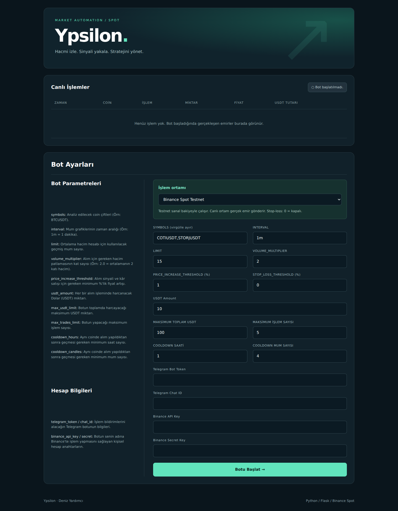
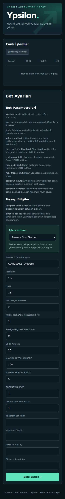

# Ypsilon · Crypto Trading Bot

**Deniz Yardımcı** · Python / HTML / CSS / JavaScript

A local Flask dashboard for a Binance Spot bot that combines volume spikes with price momentum. Configure the strategy, watch execution history, and receive optional Telegram notifications.



## Run locally

Python 3.11 or newer is recommended. Tested with Python 3.12.

```bash
git clone https://github.com/dnzyrdmc/crypto-python.git
cd crypto-python
python -m venv .venv
```

Activate the environment:

```powershell
# Windows PowerShell
.venv\Scripts\Activate.ps1
```

```bash
# macOS / Linux
source .venv/bin/activate
```

```bash
python -m pip install -r requirements.txt
python app.py
```

Open **http://127.0.0.1:5000**. Open the panel through Flask rather than double-clicking the HTML file. The server starts idle; loading the page never places an order.

1. Select Binance Spot Testnet (default) or the live Binance environment.
2. Enter API credentials for that environment. Testnet credentials and live credentials are different.
3. Set symbols and strategy parameters. Telegram is optional; provide both token and chat ID to enable it.
4. Start the bot. The panel reports connection progress and the actual worker status. Live mode asks for confirmation.

## Strategy preserved

- Entry: latest candle volume exceeds the mean of preceding candles multiplied by `volume_multiplier`, **and** latest close rises by more than `price_increase_threshold` relative to the preceding close.
- Exit: the same percentage is used as the take-profit threshold. This preserves the supplied strategy, including analysis of the still-forming latest candle.
- Optional stop-loss: the absolute value of `stop_loss_threshold` is used; **0 disables it** (the original bot's default behavior).
- Per-symbol open-position protection, same-candle protection, hour/candle cooldowns, cumulative purchase budget and cumulative buy-count limit.
- The buy-count and spend limits apply to the current process session, not concurrent positions. Sales do not replenish these limits.
- Quote-weighted execution prices and base-asset commission deduction before sell-quantity rounding.

## Project layout

```text
app.py                  Flask endpoints, validation and worker lifecycle
bot.py                  Original strategy and Binance/Telegram integration
starter-page.html       Dashboard markup and JavaScript
static/panel.css        Responsive dashboard styling
requirements.txt        Runtime dependencies
requirements-dev.txt    Test dependencies
tests/                  API and mocked trading-flow tests
docs/                   Actual desktop and mobile screenshots
```

The original languages remain: **Python, HTML, CSS and JavaScript**. No frontend framework or build step is required. Visual assets and styling are local, so the dashboard does not depend on a CDN.

## Tests

```bash
python -m pip install -r requirements-dev.txt
python -m pytest -q
```

Tests cover validation, duplicate starts, connection-failure status, buy/take-profit and buy/stop-loss flows, and commission-adjusted sell quantity. Exchange calls are mocked; no real orders are submitted. Screenshots show the actual idle application, not fabricated trading results.

## Operating boundaries

- Run one server process locally. The panel has no login and is not intended for public hosting. Debug mode and unrestricted CORS are disabled; credentials are not printed or saved by the app.
- Use Ctrl+C in the terminal to stop the process. **Stopping does not sell holdings.** Open-position tracking and trade history are in memory and do not survive a restart; check the exchange account before restarting.
- Exits are monitored approximately every 10 seconds while this process runs; they are not exchange-hosted stop orders. Exchange filters, minimum notionals, slippage, fees and network failures can prevent execution. The configured USDT figure is a target, not a guaranteed maximum after price changes and fees.
- An ambiguous buy response blocks further buys for that symbol. Failed/ambiguous sells and monitor timeout require manual account review; automatic reconciliation is not implemented. Other symbol workers may continue. Do not infer that an error message has closed a position.
- Live exchange connectivity and live-money execution were **not** tested as part of this update. Start by verifying the chosen symbols and credentials on Testnet.

<details>
<summary>Mobile screenshot</summary>



</details>

## Related articles

- [Binance API’si ile Otomatik Ticaret Botu Oluşturmaya Giriş](https://medium.com/@denizyardimci/binance-apisi-ile-otomatik-ticaret-botu-olu%C5%9Fturmaya-giri%C5%9F-6d9970bed9bb)
- [Binance API ile Otomatik Ticaret Botu Oluşturmaya Giriş (Part 2)](https://medium.com/@denizyardimci/binance-api-ile-otomatik-ticaret-botu-olu%C5%9Fturmaya-giri%C5%9F-b%C3%B6l%C3%BCm-2-c8e710e9c7c7)
